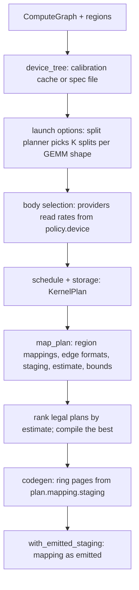

# The device-tree planner: what was built

**Written 2026-11-15.** This document describes the planner architecture built from [memory-planner-research.md](memory-planner-research.md): what each part is, how it plugs into the compiler, how it was validated, and what was left out. [architecture.md](architecture.md) describes the rest of the compiler.

All measurements are from the H200 MIG slice (60 SMs). No full GPU and no non-Hopper GPU was available.

## 1. Summary

The compiler now plans a launch against a **device tree**: a description of the device's storage levels, the edges data moves along, synchronization costs and per-body rates. A **cost model** estimates the time of a plan from that tree. The planner uses it to make three decisions that were fixed rules or environment flags before, and it attaches its reasoning to every plan.

What exists now:

| Part | Module | Purpose |
|---|---|---|
| Device tree | `device.py`, `devices/*.yaml` | One description per device: levels, shared-edge bandwidth curve, transfer mechanisms, sync costs, body rates. Spec files for H100, B200, MI300X and TPU v7; a calibrated file for the H200 slice |
| Einsum view | `einsum.py` | Ranks and index sets of a `TensorProgram`: reuse, traffic of a tiling, HBL lower bound |
| Cost model | `costmodel.py` | Time of an interval and a plan; the bound ladder B0–B3 |
| Mapping | `mapping.py` | What the planner decided: region mappings, edge formats, staging, estimate. Lives on `KernelPlan.mapping` |
| Search | `search.py` | Pareto pruning and a join over shape classes under shared reservations |
| Staging planner | `staging.py` | Sizes the producer's page ring from the plan and the tree |
| Calibration | `calibration.py`, `machine.py` | New probes: write bandwidth, one warp's load rate, dependent-load latency and its slowdown beside streams |
| Report and fit | `tools/plan_report.py` | Model against measurement per interval; bounds; fits body rates inside the kernel |

What the result is, in short:

- **The kernels did not change on this device.** On every model run, the new planner chose what the fixed rules chose (unsplit GEMMs, a 20-page ring, the same attention splits), and the generated modules are byte-identical to the old planner's. That is the expected outcome on a device the rules were tuned on; §6.2 has the numbers.
- **The decisions are now derived.** The ring size comes from the tree and the plan; K splits come from the cost model; the attention split rates come from the device file. On a different tree the same code decides differently (unit tests plan a 132-SM tree and a slow-leaf tree).
- **The model is accurate enough to rank.** Rates fitted on SmolLM-135M predict the other models' kernels to within 7% in total and 5–10% per interval (§6.4), and the model never prefers the slower kernel in the decisions that were A/B-measured (§6.3).
- **No speedup is claimed.** This work makes the planner portable and explainable. It does not make decode faster on the H200 slice.

## 2. Where it sits in the compiler



The entry point is `compile_post_grad` in `compiler.py`:

1. `device_tree(target)` builds the tree. It uses the device's calibration cache (`tools/calibrate.py`) when one matches the target's SM count, else the spec file of the target's family with the target's SM count. It never measures.
2. The tree goes into `SelectionPolicy.device`, so every provider and the planner see it.
3. `launch_options(graph, target, table_launch, tree)` asks the generation for launch-wide choices. On Hopper, `plan_splits` chooses each GEMM shape's K split.
4. `search_plans` builds the legal plans as before, calls `map_plan` on each, and orders them by estimated time before compiling (`_rank_by_estimate`).
5. Codegen reads `plan.mapping.staging` for the producer's ring size.
6. After codegen, `with_emitted_staging` records what was emitted (codegen may fit fewer pages or drop the producer) and re-estimates.

A launch planned without a tree (`SelectionPolicy.device is None`, or `MEGABAKE_PLAN_WITH_TREE=0`) behaves as before this work. Tests that pass their own policy are unaffected.

## 3. The parts

### 3.1 Device tree (`device.py`, `devices/`)

A `DeviceTree` has:

- **`levels`**, root first: name, capacity, fan-out, and whether the level is software-managed. Only software-managed levels can hold a planned tile. L2 and AMD's Infinity Cache are hardware-managed.
- **`edges`**: for each data path, total read and write throughput **as a curve over the number of active leaves**, the transfer mechanisms with a latency each, and the measured contention factor.
- **`sync`**: grid-barrier cost by workers, counter round trip, interval skew. `handoff_s` (half a counter round trip) is the fastest any dependent hand-off can be.
- **`bodies`**: rate tables per body family (`gemm`, `attention_decode`, `generic`).
- **`provenance`**: for each group of numbers, whether it is spec, assumed, measured or fitted.

The useful accessors are `read_share(active)`, `barrier_s(workers)`, `flops_per_s(dtype)`, `mechanism()`, `body(family)` and `staging_depth_s(level)`.

Files in `src/megabake/devices/`:

| File | What it is |
|---|---|
| `h100.yaml` | Hopper family spec. Edges are assumed from the H200 slice until a full H100 is calibrated |
| `h200-mig-3g71gb.yaml` | The development device as calibrated on 2026-11-15. Unit tests use it |
| `b200.yaml` | Blackwell spec. Body rates are Hopper's, as assumptions |
| `mi300x.yaml` | AMD CDNA 3: four levels (HBM → Infinity Cache → 8 XCD L2 → 38 CUs each), thread-issued loads only. No bodies |
| `tpu-v7.yaml` | TPU v7: two TensorCores with 64 MiB of software-managed VMEM each, DMA, no barriers. No bodies |

A shared edge can be given as measured points or as `{peak, per_child}`. The second form expands to `1 / sqrt((k·per_child)⁻² + peak⁻²)`, which fits the measured H200 curve within 3–5%.

**Adding a device of a known family:** copy the family's spec file, set the level sizes and fan-out, run `tools/calibrate.py`, then `tools/plan_report.py --fit` on a small model. No code changes. **A new family** (AMD, TPU) also needs bodies and a code generator; the tree files for them exist so that the planner and cost model can be exercised on those shapes.

### 3.2 Einsum view (`einsum.py`)

`einsum_view(program)` turns a `TensorProgram` into ranks (the iteration domains), tensors (each with the set of ranks that index it), the reduced ranks and the number of accumulators. Nothing is declared by hand: a tensor is reused along every rank that does not index it.

On top of the view:

- `tile_fetches` and `traffic_bytes`: bytes fetched from the parent level for a tile per rank, a loop order, and the ranks that are split across leaves. A tensor is refetched for every iteration of a loop it does not depend on that sits outside one of its own loops; leaves share no buffer.
- `hbl_tile` and `traffic_lower_bound_bytes`: the dual HBL linear program with loop bounds, solved exactly by vertex enumeration (no solver dependency). It gives the tile shape that does the most work per buffer and a lower bound on traffic into a buffer of a given size.
- `attention_scores`: decode attention as `S[g,j,t] = Q[g,j,d]·K[g,t,d]`. `K` has no `j`, so a KV group's query heads can share one read of it. The KV-group packing rule that was found by experiment on 2026-10-27 follows from this index set (`test_kv_group_packing_follows_from_the_index_sets`).

`accounting.phase_traffic` now takes FLOPs from the view instead of guessing from 2-D input shapes. On SmolLM-135M decode all 278 phases give the same number as the old rule.

For batch-1 decode the bound confirms what the research report said: `traffic_lower_bound_bytes` equals the bytes read once, at any buffer size. Tiling cannot reduce HBM traffic there.

### 3.3 Cost model (`costmodel.py`)

The model works on a neutral description: a kernel is a list of `Interval`s, and an interval holds `Work` items.

```text
one item on one leaf, k leaves active:
    t_item = fixed + max(bytes / min(share(k), rate_cap), flops / engine)

one interval:
    T = max over leaves (Σ start + Σ t_item) + barrier(workers) + skew
```

What it models beyond a roofline:

- **Waves.** Items are dealt to leaves end to end across the regions of an interval, as codegen rotates them. A tail wave on few leaves gets a larger share of the edge.
- **Saturation.** `share(k)` is the measured curve, so more active leaves add little once the edge saturates.
- **Fixed costs.** `start` (once per leaf and region) and `fixed` (per item) do not scale with bytes.
- **Pipeline depth.** A GEMM keeps `depth_bytes` in flight (its stages, or its ring pages). It cannot stream faster than `depth_bytes / copy latency`.
- **Recompute.** A folded producer runs on every leaf before the leaf's own items.
- **Synchronization.** A grid barrier, a counter, or none.

`gemm_work`, `attention_work` and `generic_work` build `Work` from a body family's rates in the tree. `plan_intervals(plan, tree, kv_valid_length)` builds the intervals of a real `KernelPlan`.

`form="roofline"` and `form="x23"` (the 2026-11-07 starting form) are kept so the forms can be compared.

**Bounds** (`plan_bounds`), each adding one constraint:

| Bound | Meaning |
|---|---|
| B0 | Bytes at the device's bandwidth, FLOPs at its peak |
| B1 | With the bytes a leaf of this capacity must move (einsum bound) |
| B2 | With the bandwidth the plan's active leaves reach |
| B3 | Plus one hand-off between dependent intervals |

### 3.4 Mapping (`mapping.py`)

`KernelPlan` has a new field, `mapping`, a `KernelMapping`:

- `regions`: one `RegionMapping` per selected body: its einsum view, the leaf tile per rank, the loop order, the ranks split across leaves, K splits and pipeline stages. `items`, `leaf_bytes` and `traffic_bytes` follow from those.
- `edges`: the `EdgeFormat` (level, dtype, strides) of every value one body hands to another.
- `staging`: the `StagePlan` (producer on or off, ring pages, reason).
- `estimate`: the cost model's `PlanEstimate` with the bounds.
- `tree`: the device tree the plan was mapped on.

`mapping.report()` gives a readable plan point. `tools/plan_report.py` prints it.

### 3.5 Search (`search.py`)

Choices come in shape classes: a decoder repeats a few (body, shape) classes many times. A class offers `Candidate`s with a time and shared reservations. `join` picks one candidate per class under a capacity, keeping only Pareto-optimal partial kernels, and `best_of` compares launch-wide alternatives. A candidate must beat the class's default by `MARGIN` (5%), because the model's error is larger than small differences.

The first user is `plan_splits` in `bodies/cuda/sm90/gemm.py`. Splitting K is a launch-wide trade: a split GEMM puts more leaves on the edge, but one split GEMM takes the producer away from every GEMM of the kernel. So the planner joins two kernels, one unsplit with staged starts and one with splits and no producer, and takes the split one only if it wins by the margin.

`search_plans` also uses the model: `_rank_by_estimate` orders the legal plans so the compile budget goes to the plans the model ranks best. Table launches now consider three legal plans (the worker-count variants) and compile one.

### 3.6 Staging planner (`staging.py`)

`plan_staging` sizes the producer's page ring:

```text
pages = (in flight + run-ahead) / page, rounded up to even, at most what fits

in flight = one leaf's best rate × the bulk copy's latency
run-ahead = what the idle time before a weight-heavy interval can fill,
            at most what that interval's busiest leaf takes
```

The ring is both the GEMM's pipeline and the producer's look-ahead, so both terms count. With the calibrated tree this gives 82 KiB + 72 KiB = 20 pages for SmolLM-135M, and "as many as fit" for larger models. That matches the fixed 20 and X1.0's finding that the gain saturates at 20–24 pages, without either number in the code. `MEGABAKE_RING_PAGES` still forces a size for experiments.

### 3.7 Calibration (`calibration.py`, `machine.py`)

`MachineModel` (version 2) gained:

| Field | Probe |
|---|---|
| `hbm_write_bytes_per_s_by_ctas` | Streaming write with 1, half and all SMs |
| `thread_load_bytes_per_s` | One warp of one CTA reading with ordinary loads |
| `dram_latency_s` | Pointer chase over 256 MiB: one dependent load |
| `contention_by_utilization` | The same chase in a kernel whose other SMs stream |
| `body_rates` | Rates fitted inside a kernel by `tools/plan_report.py --fit` |

Measured on the slice: write 2,261 GB/s with 60 CTAs (63 GB/s with one); one warp's loads 10 GB/s; a dependent DRAM load 139 ns.

Body rates are fitted **inside the megakernel**, from the phase timer's per-interval spans, because rates in a standalone kernel differ (X0.4). `--fit` runs coordinate descent on the GEMM start and tile costs, the generic body costs and the interval skew. Three runs calibrate a device:

```bash
.venv/bin/python tools/calibrate.py --force
.venv/bin/python tools/plan_report.py --fit                                   # staged kernel
MEGABAKE_PRODUCER_WARP=0 .venv/bin/python tools/plan_report.py --fit --fit-only gemm.start_s
MEGABAKE_RING_PAGES=10   .venv/bin/python tools/plan_report.py --fit --fit-only edge.latency_s
```

The last one fits the bulk copy's latency from a kernel with a shallow ring, where the ring's depth limits the stream rate.

### 3.8 Attention rates

The split cost model's rates (`DECODE_ITEM_FIXED_S` and seven others) were constants in `bodies/cuda/sm90/attention.py`, marked `shortcut:`. They are now a `DecodeRates` read from the device tree (`bodies.attention_decode`). The values are unchanged, so the generated kernels are too. `decode_row_split` tells the cost model how a decode body divides its rows at a given key count.

## 4. What the planner decides now

| Decision | Before | Now | Changes the kernel? |
|---|---|---|---|
| K split per GEMM shape | Off; `MEGABAKE_SPLIT_K=1` splits by a tile-count rule | `plan_splits`: cost model, launch-wide join against losing the producer | Yes, where the model says so. Not on the slice |
| Producer ring pages | 20 (`MEGABAKE_RING_PAGES`) | `plan_staging` from the tree and the plan | Yes. 20 on every model run here |
| Attention split steps | Constants in the body | The same cost function with rates from the device file | Same values today |
| Which legal plan compiles (table launches) | The greedy seed, unranked | The best of three by estimate, default unless beaten by 5% | The default was chosen in every run |
| FLOP accounting | Guessed from 2-D input shapes | From the einsum view | No |

Not decided by the planner (still fixed in code): tile shapes inside bodies, the swapAB token tile, the interval-folding limits in `schedule.py`, the KV-packing thresholds (`DECODE_PACKED_*`), and whether a kernel can have a producer at all.

## 5. Tools and switches

| Tool or switch | Use |
|---|---|
| `tools/calibrate.py [--force]` | Measure the device; stored in `~/.cache/megabake/machine/` |
| `tools/plan_report.py --model M --context N [--mode prefill]` | Model against measurement per interval, bounds, mapping |
| `tools/plan_report.py --fit [--fit-only F.R ...]` | Fit body rates to this kernel and save them with the calibration |
| `MEGABAKE_PLAN_WITH_TREE=0` | Plan with the fixed rules (for A/B) |
| `MEGABAKE_RING_PAGES=n` | Force the ring size |
| `MEGABAKE_SPLIT_K=1`, `MEGABAKE_SPLIT_K_FORCE` | Force splits, as before |
| `experiments/newarch/ab.py` | A/B arms in one process with the model's prediction per arm |

## 6. Validation

Everything below was run on 2026-11-15 on the H200 MIG slice. Artifacts are in `artifacts/newarch_2026-11-15/` (not tracked). Body rates were fitted once, on SmolLM-135M decode at 100 cached keys; every other model and context is held out.

### 6.1 Tests

- Unit tests: 210 pass. 37 are new (`test_device.py`, `test_einsum.py`, `test_costmodel.py`, `test_search.py`).
- GPU and integration tests: 47 passed, 23 skipped (other architectures), with the known failure `test_phase_runtime_ports_delay_idle_rebinding_and_largest_grid` deselected.
- That full GPU run came before four small edits: the calibrated-tree rule of §7, a cleanup of the bounds code, the removal of an unused parameter, and a cache for the lower bound. After the first three I reran the table-launch, plan-cache, transformer-block, full-model and stall-diagnostics GPU tests (7 passed, 9 skipped). After the last one I reran the unit tests and the SmolLM-135M identity check of §6.2. The whole GPU suite was not repeated.

### 6.2 The kernels are unchanged

Old planner (`MEGABAKE_PLAN_WITH_TREE=0`) against the new one, compiled in one process and timed interleaved (`experiments/newarch/ab.py`, 3 rounds of 20 calls, profiler kernel time):

| Model | Keys | New µs | Old µs | Old vs new | Ring pages | Same generated module | Same logits |
|---|---:|---:|---:|---:|---:|---|---|
| SmolLM-360M | 100 | 1,109.3 | 1,115.8 | +0.59% | 20 | yes | bit-identical |
| Qwen2-0.5B | 100 | 1,135.3 | 1,138.8 | +0.31% | 20 | yes | bit-identical |
| Qwen3-0.6B | 100 | 1,378.5 | 1,379.3 | +0.06% | 20 | yes | bit-identical |
| Llama-3.2-1B | 100 | 1,526.2 | 1,528.6 | +0.16% | 20 | yes | bit-identical |
| SmolLM-1.7B | 100 | 2,185.7 | 2,198.9 | +0.60% | 20 | yes | bit-identical |
| SmolLM-135M | 2,000 | 1,001.8 | 996.5 | −0.53% | 18 | yes | bit-identical |
| Llama-3.2-1B | 2,000 | 1,684.9 | 1,684.3 | −0.04% | 18 | yes | bit-identical |

The two arms are the same module, so the differences are run-to-run noise. At 2,000 keys the ring is 18 pages in both arms: the attention scratch is larger and 18 pages are what fit.

SmolLM-135M at 100 keys, final code against the tree before this work: the generated module has the same hash (`38f0395e3e2f3d53`), the logits are bit-identical, and the kernel takes 842.3 against 842.3 µs.

Planning cost: mapping a 278-phase plan takes 0.08 s (the lower bound is solved once per shape). SmolLM-135M compiles in 21–29 s with or without the tree; the spread between runs is larger than any difference.

Greedy text (`tools/greedy_check.py`, 64 tokens): Llama-3.2-1B and SmolLM-135M give the same result as the 2026-11-09 record. Llama-1B differs from eager bf16 in one token at position 37, as before; eager matches Hugging Face `generate`.

### 6.3 The model against measured decisions

SmolLM-135M decode, 100 keys, five kernels in one process, 3 interleaved rounds. "Predicted" is the cost model's estimate of each kernel against its estimate of the default:

| Kernel | µs | Measured | Predicted | Roofline |
|---|---:|---:|---:|---:|
| New planner (default) | 841.7 | — | — | — |
| Old planner | 844.2 | +0.30% | 0.0% (same kernel) | 0 |
| No producer (`MEGABAKE_PRODUCER_WARP=0`) | 877.7 | +4.28% | +1.7% | 0 |
| Ring of 10 pages | 853.6 | +1.41% | 0.0% | 0 |
| Split-K (`MEGABAKE_SPLIT_K=1`, 3 splits on the 9-tile GEMMs) | 908.6 | +7.95% | +4.58% | 0 |

- The model never prefers the slower kernel. It under-predicts the sizes.
- A ring of 10 pages comes out as a tie, so the default stays. The ring's depth shows in the model only where it caps a leaf's stream rate. An earlier sweep measured 14 pages at +0.45%.
- A roofline moves the same bytes in all five kernels and predicts no difference.
- Before the bulk copy's latency was fitted (assumed 1.5 µs, fitted 1.06 µs), the same table read +4.3%, +7.6% and +5.6%: the ring effect was over-predicted. The fit from a shallow-ring kernel is part of the calibration now (§3.7).
- Split-K changes the logits (max difference 0.375), as its accumulation order differs.

`tests/unit/test_costmodel.py` keeps these three decisions as a regression test, with the measured sizes, and adds three from the log that could not be re-measured in one process: short contexts do not split attention and long ones do, folding a small producer beats a barrier interval, and splitting pays only where the edge is far from saturated.

### 6.4 The model against measured intervals

`tools/plan_report.py`, phase timer. "Measured" and "predicted" sum the timed barrier intervals; the final interval (the LM head) has no closing barrier and is not timed. "Shape ρ" is the rank correlation over the distinct interval shapes of the model.

| Model | Keys | Intervals | Measured µs | Predicted µs | Predicted ÷ measured | Error per interval | Shape ρ |
|---|---:|---:|---:|---:|---:|---:|---:|
| SmolLM-135M (fitted) | 100 | 151 | 806 | 818 | 1.015 | 7.9% | 0.82 |
| SmolLM-135M | 2,000 | 151 | 961 | 967 | 1.006 | 6.3% | 0.93 |
| SmolLM-360M | 100 | 161 | 1,007 | 1,074 | 1.067 | 8.6% | 1.00 |
| Qwen2-0.5B | 100 | 121 | 997 | 1,009 | 1.012 | 6.8% | 0.96 |
| Qwen2-0.5B | 2,000 | 121 | 1,231 | 1,180 | 0.959 | 7.7% | 0.93 |
| Qwen3-0.6B | 100 | 141 | 1,228 | 1,249 | 1.017 | 9.9% | 0.96 |
| Llama-3.2-1B | 100 | 81 | 1,308 | 1,351 | 1.033 | 5.2% | 1.00 |
| Llama-3.2-1B | 2,000 | 81 | 1,442 | 1,498 | 1.038 | 5.9% | 1.00 |
| SmolLM-1.7B | 100 | 121 | 2,078 | 2,223 | 1.070 | 7.3% | 1.00 |

Whole kernels, LM head included (from the A/B runs of §6.2 and §6.3): the estimate is 0.1% to 6.2% above the measured kernel time on all eight cells (SmolLM-135M at 2,000 keys +0.1%, Llama-3.2-1B at 100 keys +5.0%, SmolLM-1.7B +6.2%).

By interval kind, predicted over measured is 0.97–1.08 for GEMM intervals, 1.02–1.20 for norm + gate·up, and 0.81–1.11 for attention. Attention is worst on Qwen3-0.6B (0.81), whose q/k-norm runs outside the attention body. The single elementwise-only interval of each model is under-predicted (0.46–0.84); it is 2–4 µs per kernel.

The 2026-11-07 pass rule for the cost model was a rank correlation of at least 0.8 on held-out cells. It holds on all eight.

### 6.5 The bound ladder

Measured time of the timed intervals over each bound:

| Model | Keys | ÷ B0 | ÷ B2 | ÷ B3 |
|---|---:|---:|---:|---:|
| SmolLM-135M | 100 | 8.65 | 4.75 | 3.41 |
| SmolLM-360M | 100 | 3.67 | 2.63 | 2.22 |
| Qwen2-0.5B | 100 | 3.21 | 2.23 | 1.99 |
| Qwen3-0.6B | 100 | 3.18 | 2.35 | 2.10 |
| Llama-3.2-1B | 100 | 1.55 | 1.43 | 1.38 |
| SmolLM-1.7B | 100 | 1.48 | 1.38 | 1.33 |

B1 is within 0.3% of B0 on every model: batch-1 decode has no tiling freedom. For small models most of the distance to the roofline (B0) is structural: with the plan's work split (B2) and one hand-off per interval (B3), SmolLM-135M is at 3.4× instead of 8.7×. What remains above B3 is the bodies' fixed cost per interval.

### 6.6 What the planner says about other devices (not measured)

On spec trees the split planner decides differently. These are model outputs on assumed numbers; nothing here was run:

| Tree | Leaves | Llama-3.2-1B K splits |
|---|---:|---|
| H200 slice (calibrated) | 60 | none |
| H100 (spec) | 132 | k and v: 16; down: 4 |
| B200 (spec) | 148 | k and v: 16; q and o: 4; down: 4 |
| MI300X (spec, Hopper body rates) | 304 | k and v: 16; q, o and down: 8 |

So the model answers the roadmap's open question "does split-K help on a full 132-SM GPU?" with yes for the narrow projections, at the price of the producer. That needs an H100 run before anyone believes it; see the rule in §7.

Staging depth (free software-managed capacity over root bandwidth) from the same files: H100 shared memory 10.6 µs, the H200 slice 6.0 µs, B200 5.6 µs, MI300X LDS 4.5 µs, TPU v7 VMEM 18.2 µs.

## 7. Safety rule: only a calibrated tree changes a kernel

`DeviceTree.measured` is true when the edges were measured on the device. On a tree that is only a spec file, the planner still estimates and reports, but `plan_splits` is not consulted and codegen keeps the fixed ring size. A GPU that was never calibrated therefore gets the same kernel as before this work. Run `tools/calibrate.py` and `tools/plan_report.py --fit` to let the planner decide.

## 8. Changes to existing files

| File | Change |
|---|---|
| `compiler.py` | Builds the tree, puts it in the policy, passes it to launch options; table launches consider three legal plans; reconciles the mapping after codegen; the tree's digest is in the plan cache key |
| `plan.py` | `KernelPlan.mapping`; `search_plans` maps each legal plan and ranks them by estimate |
| `planner.py` | `map_plan`, `with_emitted_staging`, `producer_possible`, ring page constants |
| `codegen.py` | Ring pages from the staging plan; `LaunchMetadata.ring_pages` |
| `bodies/interface.py` | `SelectionPolicy.device`; launch options take the tree |
| `bodies/catalog.py` | Passes the tree to the generation's launch options |
| `bodies/cuda/sm90/gemm.py` | `plan_splits`; `HopperLaunchOptions.splits` |
| `bodies/cuda/sm90/attention.py` | `DecodeRates` from the tree in place of eight constants; `decode_row_split` |
| `accounting.py` | FLOPs from the einsum view |
| `machine.py`, `calibration.py`, `tools/calibrate.py` | Model version 2, new probes, `save_machine_model` |
| `runtime.py`, `cache.py` | `plan_with_tree`, `ring_pages_forced`; cache key |
| `pyproject.toml` | `pyyaml` dependency; device files as package data |

The staged changes that were in the index when this work started (`attention.py`, `ops/attention.py`, `planner.py`, `regions.py`, `tools/attention_variants.py`) are untouched in the index; the edits here are on top, unstaged. Nothing was committed.

## 9. What was not built, and what differs from the research report

- **Contention is measured but not used.** The probe shows dependent DRAM loads run 2.13× slower in a kernel whose other SMs stream. The cost model does not multiply by it: body rates are fitted inside the kernel and already contain the effect, and applying the factor on top doubled the attention estimate. The factor stays in the device file as a measurement.
- **No overlap coefficient.** The model takes `max(stream, compute)` per item. Decode is not compute-bound, so nothing here could calibrate it.
- **Bodies do not declare mapspaces.** The only body knob the planner chooses is the GEMM's K split. Tile shapes, the swapAB token tile and stage counts are still fixed in the bodies, so the "work items ≥ SM count" rule for a 132-SM device can only be met by splitting K.
- **Edge formats are recorded, not searched.** No body offers a second input or output format yet, so the join has nothing to choose there.
- **The staging planner only sizes the ring.** It does not pause the producer during latency-critical phases and does not stage attention K and V.
- **One plan is compiled for a full model.** Measuring the top two or three is available through `search_budget`, not on by default: each compile costs tens of seconds to minutes.
- **No second device.** The B200, MI300X and TPU v7 trees are spec files exercised by unit tests. The claim "a new chip of the same family is a tree file" is still untested on hardware.
- **Fitted constants that remain in code:** the interval-folding limits (`_FOLD_*` in `schedule.py`), the KV-packing thresholds (`DECODE_PACKED_*`), `SPLIT_K_MAX` and the minimum K tiles per split. In the device file, `split_exchange_s` (1.5 µs) is an assumption and the attention rates are still the 2026-11-07 fits.
- **Two GEMM start rates are not separately identifiable.** `start_s` and `staged_start_s` are each fitted in their own kernel state together with the stream cap, and the fit put the staged one higher (1.62 against 1.46 µs). The producer's gain appears in the model through the deeper ring's stream rate. The rates predict totals; do not read them as the latency of the first stage.

## 10. Findings along the way

- **Dependent loads stay slow after any streaming in the same kernel.** A pointer chase takes 139 ns per load alone. In a kernel where other SMs stream, it takes about 2.1× that, and it stays that slow for the rest of the kernel, long after the streams end (tested up to 50 ms). One other streaming program is enough. The cause is unknown. This is the megakernel's normal condition and may be part of why latency-bound work is slow in it.
- **The `--cta` profile is not a fair clock any more.** With per-CTA stamps the SmolLM-135M kernel takes 1,106 µs against 842 µs untimed. The phase timer (one stamp per barrier) does not show this, so rates are fitted from it.
- **Ring depth is pipeline depth.** 10 pages cost +1.4%, 14 pages +0.45% against 20 on SmolLM-135M. The ring must hold what a leaf keeps in flight, not just one tile of run-ahead.
- **One warp issues about 10 GB/s** with ordinary loads; one CTA writes 63 GB/s and reads 80 GB/s.

## 11. Next steps

1. Calibrate on a full H100 or H200 and repeat §6.3 there. The split-K prediction of §6.6 is the first thing to check.
2. Fit `split_exchange_s` from a split kernel and the attention rates from `plan_report --fit`, so that no rate in the device file predates this work.
3. Let the cost model decide interval folding and KV packing; both have their inputs now (sync cost, einsum traffic).
4. Give bodies a declared mapspace, starting with the GEMM's row tile, so coverage on wide devices does not depend on split-K.
5. Find the cause of the persistent slowdown of dependent loads.
